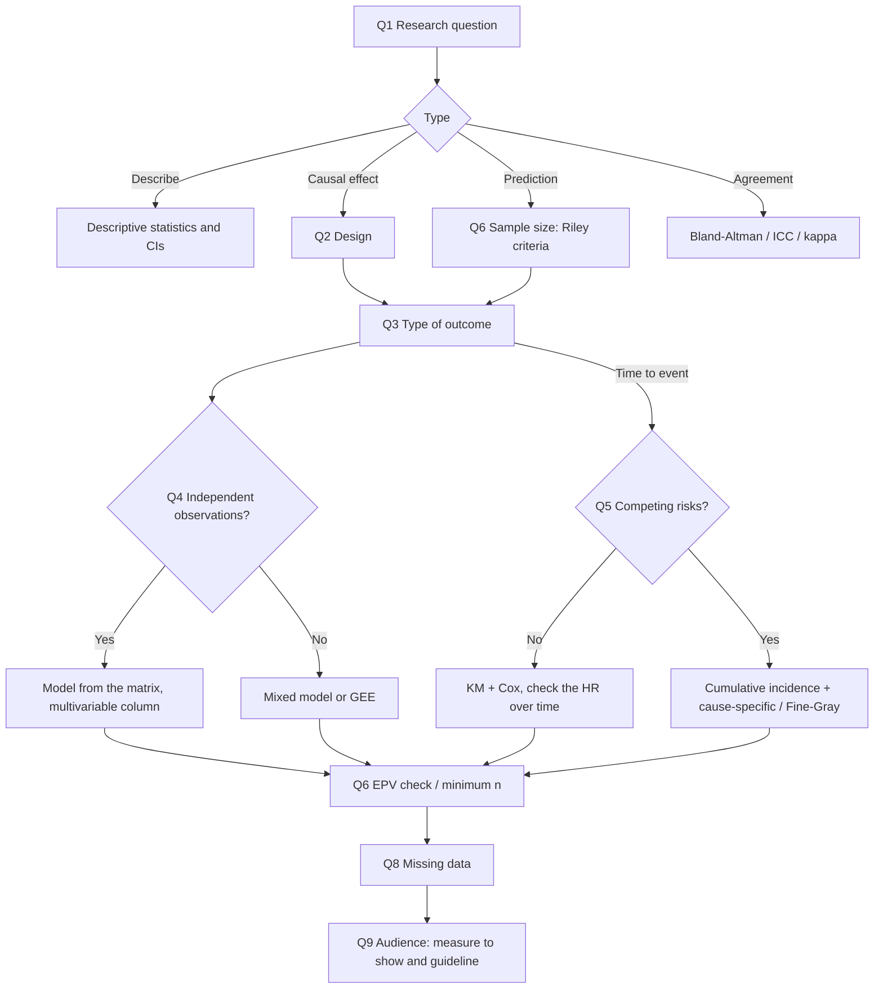

# Choosing a statistical model: the evidence behind the app

Working document, version 0.2 (6 November 2026).
It collects the rules the app applies and, for each one, the publication it comes from.
No rule in the app should exist without an entry in the [bibliography](#bibliography).

## Contents

1. [Search method](#1-search-method)
2. [The questions the app asks](#2-the-questions-the-app-asks)
3. [Outcome × data structure → model](#3-outcome--data-structure--model)
4. [Sample size](#4-sample-size)
5. [Effect measure and audience](#5-effect-measure-and-audience)
6. [Rules by model family](#6-rules-by-model-family)
7. [Rules that apply to every model](#7-rules-that-apply-to-every-model)
8. [The three audiences: exam, clinicians, publication](#8-the-three-audiences)
9. [Draft decision tree](#9-draft-decision-tree)
10. [Open points](#10-open-points)
11. [Descriptive analysis](#11-descriptive-analysis)
12. [Designs and approaches added in version 0.2.0](#12-designs-and-approaches-added-in-version-020)
13. [Bibliography](#bibliography)

## 1. Search method

| Source         | How it was used                                                                                                 |
| -------------- | --------------------------------------------------------------------------------------------------------------- |
| PubMed         | Topic searches and citation lookups; every entry was checked on PubMed (PMID, DOI, year).                       |
| Google Scholar | It cannot be queried automatically: the 4 entries outside PubMed are marked `[not in PubMed]` and cited by DOI. |

Criteria for choosing sources, by weight:

1. Reporting guidelines (EQUATOR network) and consensus documents (for example STRATOS, ICH E9(R1)).
2. Tutorials and methods series in clinical journals (BMJ, JAMA, Anesth Analg, Circulation), suitable for students.
3. Simulation studies and systematic reviews that give a number on which to base a rule (for example events per variable).
4. Older classic papers, only when they are still the reference source (for example Bland-Altman 1986).

Limit: this is a targeted collection, not a systematic review. A published version will need a
written, reproducible search strategy (search strings, dates, inclusion criteria).

## 2. The questions the app asks

The order matters: the aim of the analysis decides the method more than the shape of the data.
Confusing causal and predictive analysis is a common error: of 180 cohort studies in high-ranking
journals, 26% conflated the two [3].

| #  | Question                                           | Possible answers                                                                                         | Why it matters                                                                                                      | Sources       |
| --- | -------------------------------------------------- | -------------------------------------------------------------------------------------------------------- | ------------------------------------------------------------------------------------------------------------------- | ------------- |
| Q1 | What is the research question?                     | Describe; estimate a (causal) effect; predict (diagnosis or prognosis); measure agreement or reliability | Each type of question has different methods, choice of covariates and quality measures                              | [1-5]         |
| Q2 | What is the study design?                          | RCT; cohort; case-control; cross-sectional; routinely collected data (EHR, registries); diagnostic study | It decides which effect measures can be estimated (only the OR in a case-control study) and the reporting guideline | [76-80]       |
| Q3 | What type of outcome?                              | Continuous; binary; ordinal; nominal (>2 categories); count or rate; time to event                       | It is the main axis of the matrix in section 3                                                                      | [32,45,57,59] |
| Q4 | Are the observations independent?                  | Yes; paired; repeated measurements on the same subject; clustered (hospitals, physicians, families)      | Correlated data need mixed models or GEE                                                                            | [54-56]       |
| Q5 | Time to event only: are there competing events?    | No; yes (for example death from another cause)                                                           | Kaplan-Meier and standard Cox analyses overestimate the cumulative risk when there are competing risks              | [50-53]       |
| Q6 | How many subjects, events and candidate variables? | Numbers                                                                                                  | It decides whether the model can be estimated and how many variables can be used                                    | [16-23]       |
| Q7 | What type of exposure and covariates?              | Binary; categorical; continuous; time-varying                                                            | Continuous variables must stay continuous; time-varying exposures change the method                                 | [11,65,66]    |
| Q8 | Is there missing data? How much?                   | None; little; a lot in the outcome; a lot in the covariates                                              | It decides between complete-case analysis and multiple imputation                                                   | [67-69]       |
| Q9 | Who are the results for?                           | University exam; clinicians; scientific publication                                                      | It does not change the right model; it changes the effect measure to show and the level of detail                   | [25,42-44,81] |

Note on Q9: the audience must not lead to a model that is wrong for the data. It changes how the
results are presented (section 5) and which formal requirements apply (section 8).

## 3. Outcome × data structure → model

First choice for each combination. Alternatives and conditions are in section 6.

| Outcome                            | Simple comparison (2 groups, independent data)     | Multivariable model (independent data)                  | Paired / repeated / clustered data              | Sources       |
| ---------------------------------- | -------------------------------------------------- | ------------------------------------------------------- | ----------------------------------------------- | ------------- |
| Continuous                         | Welch t-test; Mann-Whitney if very skewed          | Linear regression                                       | Paired t-test / Wilcoxon; linear mixed model    | [54,55,64]    |
| Binary                             | Chi-squared; Fisher if expected counts are small   | Logistic (OR); modified Poisson or log-binomial (RR)    | McNemar; mixed-effects logistic; GEE            | [32,38,56,63] |
| Ordinal                            | Mann-Whitney                                       | Ordinal logistic (proportional odds)                    | Mixed-effects ordinal model                     | [59]          |
| Nominal (>2 categories)            | Chi-squared                                        | Multinomial logistic                                    | Mixed-effects multinomial or GEE                | [64,85]       |
| Count or rate                      | Comparison of rates (Poisson)                      | Poisson with offset; negative binomial if overdispersed | Mixed-effects Poisson or negative binomial; GEE | [57,58]       |
| Time to event                      | Kaplan-Meier and log-rank                          | Cox (HR); RMST if hazards are not proportional          | Cox with frailty or robust standard errors      | [45-49]       |
| Time to event with competing risks | Cumulative incidence (Aalen-Johansen); Gray's test | Cause-specific Cox (aetiology); Fine-Gray (prediction)  | Extensions with frailty                         | [50-53]       |
| Agreement between methods          | Bland-Altman                                       | —                                                       | ICC; kappa for categorical variables            | [60,61]       |

## 4. Sample size

### 4.1 The rule of 10 events per variable (EPV) is not enough

| Source                   | Message                                                                                                                                           |
| ------------------------ | ------------------------------------------------------------------------------------------------------------------------------------------------- |
| Peduzzi 1996 [16]        | Origin of the rule: with fewer than 10 EPV, logistic regression gives biased estimates and unreliable intervals.                                  |
| Vittinghoff 2007 [17]    | The rule is too strict: in many situations 5-9 EPV give acceptable results, especially for sensitivity analyses.                                  |
| van Smeden 2016 [18]     | The evidence for 10 EPV is weak; total sample size and separation also matter. Firth's correction helps.                                          |
| van Smeden 2019 [19]     | For prediction models, EPV alone does not predict prediction error; criteria based on prevalence and n are needed.                                |
| Riley 2019, 2020 [20,21] | Recommended method for prediction models: minimum n from 4 criteria (shrinkage ≥ 0.9, small optimism, precise intercept). R package `pmsampsize`. |
| Riley 2021 [22]          | Penalisation (LASSO, ridge) does not rescue a sample that is too small: its effect is unstable precisely when n is low.                           |
| Austin 2015 [86]         | Linear regression needs only about 2 subjects per variable to estimate coefficients, standard errors and confidence intervals.                    |

### 4.2 Rules for the app

| Situation                      | Rule in the app                                                                                         | Sources      |
| ------------------------------ | ------------------------------------------------------------------------------------------------------- | ------------ |
| Prediction model               | Riley's calculation (or a pointer to `pmsampsize`); warning if n is below the minimum                   | [20,21]      |
| Causal or adjusted model       | Warning below 10 EPV, stronger warning below 5 EPV; suggest Firth or fewer covariates chosen with a DAG | [16-18,7,87] |
| Machine learning               | Strong warning: RF, SVM and neural networks may need more than 10 times the EPV of logistic regression  | [23]         |
| Very rare events or separation | Suggest Firth regression and flag the risk of sparse-data bias                                          | [18,72,87]   |

For the app: "event" = the number of subjects in the less frequent category of a binary outcome, or
the number of events for time to event. "Variable" = the number of estimated parameters (a
categorical variable with k levels counts k-1), not the number of columns.

## 5. Effect measure and audience

### 5.1 What the literature says about how clinicians read effect measures

The starting hypothesis, "clinicians read the OR better than the HR", is not supported. The
evidence says that clinicians understand risk ratios and absolute measures better, and that the OR
is often read as if it were a risk ratio.

| Source               | Finding                                                                                                                                                                |
| -------------------- | ---------------------------------------------------------------------------------------------------------------------------------------------------------------------- |
| Windish 2007 [42]    | 277 internal medicine residents: 81.6% correctly interpreted a risk ratio, 37.4% an adjusted OR from a regression, 10.5% a Kaplan-Meier analysis.                      |
| Holcomb 2001 [35]    | In 107 obstetrics articles the OR differed from the risk ratio by more than 20% in 44%; in 26% the OR was interpreted as a risk ratio.                                 |
| Davies 1998 [34]     | The OR approximates the risk ratio only when the outcome is rare (roughly below 10%); with common outcomes it exaggerates the effect.                                  |
| Knol 2011 [36]       | In trials and cohorts with common outcomes the OR overestimates the risk ratio; alternatives: modified Poisson, log-binomial regression.                               |
| Akl 2011 [43]        | Cochrane review (35 studies): natural frequencies are understood better than probabilities; relative risk reduction looks larger and is more persuasive than absolute. |
| Gigerenzer 2007 [44] | Physicians and patients understand absolute risks and natural frequencies (for example "8 in 1000") better than relative measures.                                     |
| Norton 2018 [33]     | JAMA guide: the OR is legitimate, but it should be accompanied by predicted probabilities or marginal effects to be interpretable.                                     |
| Doi 2021 [41]        | Opposing view: the OR is more "portable" than the risk ratio across populations with different baseline risk. The app cites the debate.                                |
| Hernán 2010 [46]     | The HR changes over time and has a built-in selection bias; survival curves and risk differences are clearer.                                                          |
| Uno 2014 [49]        | Proposes the RMST (mean event-free time up to a time t) as a more intuitive measure than the HR.                                                                       |

### 5.2 Rules for the app

| Outcome       | Measure for the analysis                                         | For clinicians, add                                              | Sources    |
| ------------- | ---------------------------------------------------------------- | ---------------------------------------------------------------- | ---------- |
| Rare binary   | OR (≈ risk ratio)                                                | Absolute risk by group, risk difference, NNT                     | [34,43]    |
| Common binary | Risk ratio (modified Poisson) or OR with predicted probabilities | Absolute risks as natural frequencies, NNT                       | [33,36-38] |
| Case-control  | OR (the only measure that can be estimated)                      | Explain that it is an OR; no absolute risk without external data | [39,40]    |
| Time to event | HR (Cox)                                                         | Survival curves, absolute risk at t years, RMST                  | [46-49]    |
| Continuous    | Mean difference                                                  | Clinical units (mmHg, days), not standardised coefficients       | [32]       |

The app's message for clinicians: "The OR is not a risk. Show the absolute risk in each group."

## 6. Rules by model family

### 6.1 Causal analysis of observational data

| Rule                                                                                                                                  | Sources  |
| ------------------------------------------------------------------------------------------------------------------------------------- | -------- |
| State the causal aim explicitly, without euphemisms such as "association" when the question is causal.                                | [5,9]    |
| Choose confounders with a DAG or explicit criteria, not with stepwise selection or p-values.                                          | [7,8,14] |
| Report only the coefficient of the exposure: the coefficients of the covariates have no causal meaning ("Table 2 fallacy").           | [6]      |
| To compare treatments, specify the target trial (eligibility, time zero, strategies) to avoid immortal time bias.                     | [10-12]  |
| The propensity score (matching, IPT weights) is an alternative to regression adjustment, useful with many confounders and few events. | [13]     |

### 6.2 Prediction models (diagnostic and prognostic)

| Rule                                                                                                                               | Sources |
| ---------------------------------------------------------------------------------------------------------------------------------- | ------- |
| Distinguish diagnosis (current state) from prognosis (future event): design and time horizon change.                               | [4]     |
| Follow the steps of development and validation: discrimination (AUC/C), calibration, clinical utility.                             | [27-29] |
| Always report calibration; it was missing in 79% of the studies comparing ML with logistic regression.                             | [24,30] |
| Use decision curve analysis for clinical utility.                                                                                  | [31]    |
| On average machine learning does not outperform logistic regression: difference in logit(AUC) 0.00 in studies at low risk of bias. | [24]    |
| Validate internally with bootstrapping or cross-validation; never apparent performance only. Externally when possible.             | [27,28] |

### 6.3 Time to event

| Rule                                                                                                                   | Sources    |
| ---------------------------------------------------------------------------------------------------------------------- | ---------- |
| Always describe with Kaplan-Meier curves and the number at risk.                                                       | [45]       |
| Do not choose the model on a proportionality test alone: with a non-constant HR, report curves, RMST or HRs by period. | [47-49]    |
| With competing risks, 1 − KM overestimates incidence; use the cumulative incidence.                                    | [50,51]    |
| Aetiology → cause-specific Cox; prediction of absolute risk → Fine-Gray. Report both hazards.                          | [50,52,53] |

### 6.4 Repeated measurements and clustered data

| Rule                                                                                                                     | Sources |
| ------------------------------------------------------------------------------------------------------------------------ | ------- |
| Mixed models use all available data and handle missing data if MAR; prefer them to repeated-measures ANOVA.              | [54,55] |
| GEE estimates a population-average effect; the mixed model an effect conditional on the subject. Choose by the question. | [56]    |

### 6.5 Counts, ordinal outcomes, agreement

| Rule                                                                                                      | Sources |
| --------------------------------------------------------------------------------------------------------- | ------- |
| Counts: Poisson with an offset for observation time; negative binomial if variance > mean.                | [57,58] |
| Ordinal outcomes: proportional odds logistic regression; also useful for very skewed continuous outcomes. | [59]    |
| Agreement between two measurement methods: Bland-Altman, not correlation.                                 | [60,62] |
| Reliability: ICC with its form (model, type, definition) stated.                                          | [61]    |
| Agreement between raters on categories: Cohen's kappa, weighted for ordered categories.                   | [88]    |

## 7. Rules that apply to every model

| Topic                | Rule                                                                                                                 | Sources    |
| -------------------- | -------------------------------------------------------------------------------------------------------------------- | ---------- |
| Continuous variables | Do not dichotomise them: power is lost and bias introduced. Use splines or fractional polynomials for non-linearity. | [15,65,66] |
| Variable selection   | Avoid stepwise selection based on p-values; prefer prior knowledge, DAGs or penalisation with an adequate sample.    | [14,15,22] |
| Missing data         | Describe amount and pattern; multiple imputation if MAR is plausible; sensitivity analyses.                          | [67-69]    |
| P-values             | Report estimates with confidence intervals; the p-value measures neither size nor the probability of the hypothesis. | [70,71]    |
| Interaction          | Report effects in each stratum and on both the additive and the multiplicative scale.                                | [73]       |
| Sparse data          | With few events per category estimates are inflated; use Firth or penalisation.                                      | [18,72,87] |
| RCTs                 | Adjusting for pre-specified prognostic factors increases power; define the estimand (ICH E9(R1)).                    | [74,75]    |

## 8. The three audiences

### 8.1 University exam or thesis

Aim: show knowledge of the classical method and its assumptions.

| The app should...                                                     | Sources    |
| --------------------------------------------------------------------- | ---------- |
| Propose the textbook test or model and its non-parametric alternative | [62-64]    |
| List the assumptions to check and how to check them (plots, tests)    | [32,64,84] |
| Explain the interpretation of each coefficient in one sentence        | [32,45,57] |
| Flag when the textbook method is not what one would use in an article | [65,70]    |

### 8.2 Presentation to clinicians

Aim: results that are readable and usable for decisions.

| The app should...                                                                                | Sources |
| ------------------------------------------------------------------------------------------------ | ------- |
| Show absolute risks by group next to ORs and HRs, as natural frequencies (for example 12 in 100) | [43,44] |
| Propose the risk ratio or risk difference when the binary outcome is common                      | [36,38] |
| Propose survival curves and risk at a fixed clinical time instead of the HR alone                | [46,49] |
| Avoid tables with every coefficient of the model                                                 | [6]     |

### 8.3 Scientific publication

Aim: meet the standards of the literature and the reporting guideline for the design.

| Design or type of study                         | Guideline             | Sources |
| ----------------------------------------------- | --------------------- | ------- |
| RCT (article)                                   | CONSORT 2025          | [76]    |
| RCT (protocol)                                  | SPIRIT 2025           | [77]    |
| Statistical analysis plan of an RCT             | Gamble 2017           | [83]    |
| Observational studies                           | STROBE                | [78]    |
| Routinely collected data (EHR, registries)      | RECORD                | [79]    |
| Target trial emulation                          | TARGET                | [12]    |
| Prediction models (regression or ML)            | TRIPOD+AI, PROBAST+AI | [25,26] |
| Diagnostic accuracy                             | STARD 2015            | [80]    |
| Statistical reporting in general                | SAMPL; Assel 2019     | [81,82] |
| Causal studies in respiratory and critical care | Lederer 2019          | [9]     |
| Missing data in observational studies           | TARMOS                | [69]    |

## 9. Draft decision tree

## 10. Open points

| Topic                 | To decide                                                                                |
| --------------------- | ---------------------------------------------------------------------------------------- |
| Validation of the app | Have teachers, students and researchers try the tree on real cases before wider release. |
| Updates               | Review the bibliography once a year (new EQUATOR guidelines).                            |

## 11. Descriptive analysis

Added in version 0.2.0, after a review of what the literature recommends for descriptive questions.

### 11.1 What a descriptive question needs

| Source                 | Message                                                                                                                                                                                                                                                                                   |
| ---------------------- | ----------------------------------------------------------------------------------------------------------------------------------------------------------------------------------------------------------------------------------------------------------------------------------------- |
| Lesko 2022 [89]        | A descriptive question states the target population (person, place, time), the outcome and the measure of occurrence (incidence, prevalence, average time to event). Auxiliary variables are pre-specified either as stratification factors or as nuisance variables to standardise over. |
| Fox 2022 [90]          | Descriptive epidemiology is subject to systematic and random error like causal research, and deserves the same rigour.                                                                                                                                                                    |
| Conroy 2020 [91]       | For descriptive goals, adjusting for confounding is often unnecessary and can be harmful: it changes the quantity being described.                                                                                                                                                        |
| Hernán 2019 [1]        | Description is a task of its own, distinct from prediction and causal inference.                                                                                                                                                                                                          |
| Hayes-Larson 2019 [92] | Guidance for a useful "Table 1" describing the study sample, including missing data, weights and clustered data.                                                                                                                                                                          |

### 11.2 Methods by outcome

| Outcome               | Suggested summary                                                                 | Comparing groups or populations                                                | Sources       |
| --------------------- | --------------------------------------------------------------------------------- | ------------------------------------------------------------------------------ | ------------- |
| Continuous            | Mean (SD) and median [IQR]; compare them to judge symmetry                        | Difference in means; unadjusted linear regression as a description             | [81,82,89,91] |
| Binary or categorical | Proportion with a score (Wilson) confidence interval                              | Stratified proportions; directly standardised prevalence across populations    | [93,95,89]    |
| Count or rate         | Rate per person-time with an exact Poisson confidence interval                    | Directly standardised rates (gamma interval); SMR for indirect standardisation | [94-96,57]    |
| Time to event         | Kaplan-Meier curve, median and survival at fixed times; mean time up to a horizon | Curves by stratum; cumulative incidence with competing events                  | [45,49,50,89] |

Consequence for the app: for a descriptive question, regression is offered only as an unadjusted
description of differences, or to standardise over pre-specified variables; adjustment for
confounders is flagged as usually unnecessary [91].

## 12. Designs and approaches added in version 0.2.0

| Design or approach           | Suggested method                                                                                                                  | Key points                                                                                                                                                                                                                   | Sources   |
| ---------------------------- | --------------------------------------------------------------------------------------------------------------------------------- | ---------------------------------------------------------------------------------------------------------------------------------------------------------------------------------------------------------------------------- | --------- |
| Matched case-control         | Logistic regression adjusted for the matching factors; conditional logistic regression with individual matching and sparse strata | Matching does not remove confounding by the matching factors: they must be controlled in the analysis, but a conditional analysis is not always required                                                                     | [97,98]   |
| Randomised cross-over        | Model with treatment and period effects on within-subject data (linear mixed model for continuous outcomes)                       | Analyse by sequence group; carry-over effects must be ruled out by design (wash-out); report with the CONSORT cross-over extension                                                                                           | [99,100]  |
| Non-inferiority, equivalence | Same model as for superiority; conclusions from the confidence interval compared with a pre-specified margin                      | Justify the margin; analyse both intention-to-treat and per-protocol populations; report with the CONSORT extension                                                                                                          | [101,102] |
| Meta-analysis                | Random-effects meta-analysis with the Hartung-Knapp-Sidik-Jonkman method                                                          | Report heterogeneity (tau², I²) and the prediction interval; extra caution with fewer than 5 studies; report with PRISMA 2020                                                                                                | [103-106] |
| Bayesian analysis            | An approach rather than a model: the same models with prior distributions                                                         | Justify the priors and run sensitivity analyses with different priors; priors expressible as prior data; report with BARG                                                                                                    | [107-110] |
| g-methods                    | Marginal structural models with inverse probability weights, g-formula, g-estimation                                              | Needed when time-varying confounders are affected by earlier exposure; check weights (positivity, truncation)                                                                                                                | [111-114] |
| Prevalent new-user design    | Time-conditional propensity scores within exposure sets, matching, then a Cox model in the matched cohort                         | For comparisons of a newer with an older drug, when many users of the newer drug switched from the older one; keeps the patients an incident new-user design would exclude; time zero aligned, covariates measured before it | [115,116] |

## Bibliography

Every PubMed entry gives its PMID and DOI. Entries marked `[not in PubMed]` come from Google Scholar or the publisher.

### Type of question and causal inference

1. Hernán MA, Hsu J, Healy B. A second chance to get causal inference right: a classification of data science tasks. *Chance*. 2019;32(1):42-49. doi:10.1080/09332480.2019.1579578 `[not in PubMed]`
2. Shmueli G. To explain or to predict? *Stat Sci*. 2010;25(3):289-310. doi:10.1214/10-STS330 `[not in PubMed]`
3. Ramspek CL, et al. Prediction or causality? A scoping review of their conflation within current observational research. *Eur J Epidemiol*. 2021;36:889-898. PMID 34392488. doi:10.1007/s10654-021-00794-w
4. van Smeden M, et al. Clinical prediction models: diagnosis versus prognosis. *J Clin Epidemiol*. 2021;132:142-145. PMID 33775387. doi:10.1016/j.jclinepi.2021.01.009
5. Hernán MA. The C-word: scientific euphemisms do not improve causal inference from observational data. *Am J Public Health*. 2018;108:616-619. PMID 29565659. doi:10.2105/AJPH.2018.304337
6. Westreich D, Greenland S. The table 2 fallacy: presenting and interpreting confounder and modifier coefficients. *Am J Epidemiol*. 2013;177:292-298. PMID 23371353. doi:10.1093/aje/kws412
7. Tennant PWG, et al. Use of directed acyclic graphs (DAGs) to identify confounders in applied health research: review and recommendations. *Int J Epidemiol*. 2021;50:620-632. PMID 33330936. doi:10.1093/ije/dyaa213
8. VanderWeele TJ. Principles of confounder selection. *Eur J Epidemiol*. 2019;34:211-219. PMID 30840181. doi:10.1007/s10654-019-00494-6
9. Lederer DJ, et al. Control of confounding and reporting of results in causal inference studies. *Ann Am Thorac Soc*. 2019;16:22-28. PMID 30230362. doi:10.1513/AnnalsATS.201808-564PS
10. Hernán MA, Robins JM. Using big data to emulate a target trial when a randomized trial is not available. *Am J Epidemiol*. 2016;183:758-764. PMID 26994063. doi:10.1093/aje/kwv254
11. Hernán MA, Wang W, Leaf DE. Target trial emulation: a framework for causal inference from observational data. *JAMA*. 2022;328:2446-2447. PMID 36508210. doi:10.1001/jama.2022.21383
12. Cashin AG, et al. Transparent reporting of observational studies emulating a target trial: the TARGET statement. *JAMA*. 2025;334:1084-1093. PMID 40899949. doi:10.1001/jama.2025.13350
13. Austin PC. An introduction to propensity score methods for reducing the effects of confounding in observational studies. *Multivariate Behav Res*. 2011;46:399-424. PMID 21818162. doi:10.1080/00273171.2011.568786
14. Heinze G, Wallisch C, Dunkler D. Variable selection: a review and recommendations for the practicing statistician. *Biom J*. 2018;60:431-449. PMID 29292533. doi:10.1002/bimj.201700067
15. Sauerbrei W, et al. State of the art in selection of variables and functional forms in multivariable analysis: outstanding issues. *Diagn Progn Res*. 2020;4:3. PMID 32266321. doi:10.1186/s41512-020-00074-3

### Sample size

16. Peduzzi P, et al. A simulation study of the number of events per variable in logistic regression analysis. *J Clin Epidemiol*. 1996;49:1373-1379. PMID 8970487. doi:10.1016/s0895-4356(96)00236-3
17. Vittinghoff E, McCulloch CE. Relaxing the rule of ten events per variable in logistic and Cox regression. *Am J Epidemiol*. 2007;165:710-718. PMID 17182981. doi:10.1093/aje/kwk052
18. van Smeden M, et al. No rationale for 1 variable per 10 events criterion for binary logistic regression analysis. *BMC Med Res Methodol*. 2016;16:163. PMID 27881078. doi:10.1186/s12874-016-0267-3
19. van Smeden M, et al. Sample size for binary logistic prediction models: beyond events per variable criteria. *Stat Methods Med Res*. 2019;28:2455-2474. PMID 29966490. doi:10.1177/0962280218784726
20. Riley RD, et al. Minimum sample size for developing a multivariable prediction model: part II, binary and time-to-event outcomes. *Stat Med*. 2019;38:1276-1296. PMID 30357870. doi:10.1002/sim.7992
21. Riley RD, et al. Calculating the sample size required for developing a clinical prediction model. *BMJ*. 2020;368:m441. PMID 32188600. doi:10.1136/bmj.m441
22. Riley RD, et al. Penalization and shrinkage methods produced unreliable clinical prediction models especially when sample size was small. *J Clin Epidemiol*. 2021;132:88-96. PMID 33307188. doi:10.1016/j.jclinepi.2020.12.005
23. van der Ploeg T, Austin PC, Steyerberg EW. Modern modelling techniques are data hungry: a simulation study for predicting dichotomous endpoints. *BMC Med Res Methodol*. 2014;14:137. PMID 25532820. doi:10.1186/1471-2288-14-137

### Prediction models

24. Christodoulou E, et al. A systematic review shows no performance benefit of machine learning over logistic regression for clinical prediction models. *J Clin Epidemiol*. 2019;110:12-22. PMID 30763612. doi:10.1016/j.jclinepi.2019.02.004
25. Collins GS, et al. TRIPOD+AI statement: updated guidance for reporting clinical prediction models that use regression or machine learning methods. *BMJ*. 2024;385:e078378. PMID 38626948. doi:10.1136/bmj-2023-078378
26. Moons KGM, et al. PROBAST+AI: an updated quality, risk of bias, and applicability assessment tool for prediction models using regression or artificial intelligence methods. *BMJ*. 2025;388:e082505. PMID 40127903. doi:10.1136/bmj-2024-082505
27. Collins GS, et al. Evaluation of clinical prediction models (part 1): from development to external validation. *BMJ*. 2024;384:e074819. PMID 38191193. doi:10.1136/bmj-2023-074819
28. Efthimiou O, et al. Developing clinical prediction models: a step-by-step guide. *BMJ*. 2024;386:e078276. PMID 39227063. doi:10.1136/bmj-2023-078276
29. Steyerberg EW, Vergouwe Y. Towards better clinical prediction models: seven steps for development and an ABCD for validation. *Eur Heart J*. 2014;35:1925-1931. PMID 24898551. doi:10.1093/eurheartj/ehu207
30. Van Calster B, et al. Calibration: the Achilles heel of predictive analytics. *BMC Med*. 2019;17:230. PMID 31842878. doi:10.1186/s12916-019-1466-7
31. Vickers AJ, Elkin EB. Decision curve analysis: a novel method for evaluating prediction models. *Med Decis Making*. 2006;26:565-574. PMID 17099194. doi:10.1177/0272989X06295361

### Binary outcomes and effect measures

32. Schober P, Vetter TR. Logistic regression in medical research. *Anesth Analg*. 2021;132:365-366. PMID 33449558. doi:10.1213/ANE.0000000000005247
33. Norton EC, Dowd BE, Maciejewski ML. Odds ratios: current best practice and use. *JAMA*. 2018;320:84-85. PMID 29971384. doi:10.1001/jama.2018.6971
34. Davies HT, Crombie IK, Tavakoli M. When can odds ratios mislead? *BMJ*. 1998;316:989-991. PMID 9550961. doi:10.1136/bmj.316.7136.989
35. Holcomb WL, et al. An odd measure of risk: use and misuse of the odds ratio. *Obstet Gynecol*. 2001;98:685-688. PMID 11576589. doi:10.1016/s0029-7844(01)01488-0
36. Knol MJ, et al. Overestimation of risk ratios by odds ratios in trials and cohort studies: alternatives to logistic regression. *CMAJ*. 2012;184:895-899. PMID 22158397. doi:10.1503/cmaj.101715
37. Zhang J, Yu KF. What's the relative risk? A method of correcting the odds ratio in cohort studies of common outcomes. *JAMA*. 1998;280:1690-1691. PMID 9832001. doi:10.1001/jama.280.19.1690
38. Zou G. A modified Poisson regression approach to prospective studies with binary data. *Am J Epidemiol*. 2004;159:702-706. PMID 15033648. doi:10.1093/aje/kwh090
39. Cummings P. The relative merits of risk ratios and odds ratios. *Arch Pediatr Adolesc Med*. 2009;163:438-445. PMID 19414690. doi:10.1001/archpediatrics.2009.31
40. Ranganathan P, Aggarwal R, Pramesh CS. Common pitfalls in statistical analysis: odds versus risk. *Perspect Clin Res*. 2015;6:222-224. PMID 26623395. doi:10.4103/2229-3485.167092
41. Doi SA, et al. The odds ratio is "portable" across baseline risk but not the relative risk: time to do away with the log link in binomial regression. *J Clin Epidemiol*. 2022;142:288-293. PMID 34380019. doi:10.1016/j.jclinepi.2021.08.003

### How clinicians understand effect measures

42. Windish DM, Huot SJ, Green ML. Medicine residents' understanding of the biostatistics and results in the medical literature. *JAMA*. 2007;298:1010-1022. PMID 17785646. doi:10.1001/jama.298.9.1010
43. Akl EA, et al. Using alternative statistical formats for presenting risks and risk reductions. *Cochrane Database Syst Rev*. 2011;(3):CD006776. PMID 21412897. doi:10.1002/14651858.CD006776.pub2
44. Gigerenzer G, et al. Helping doctors and patients make sense of health statistics. *Psychol Sci Public Interest*. 2007;8:53-96. PMID 26161749. doi:10.1111/j.1539-6053.2008.00033.x

### Time to event and competing risks

45. Schober P, Vetter TR. Survival analysis and interpretation of time-to-event data: the tortoise and the hare. *Anesth Analg*. 2018;127:792-798. PMID 30015653. doi:10.1213/ANE.0000000000003653
46. Hernán MA. The hazards of hazard ratios. *Epidemiology*. 2010;21:13-15. PMID 20010207. doi:10.1097/EDE.0b013e3181c1ea43
47. Stensrud MJ, Hernán MA. Why test for proportional hazards? *JAMA*. 2020;323:1401-1402. PMID 32167523. doi:10.1001/jama.2020.1267
48. Royston P, Parmar MKB. Restricted mean survival time: an alternative to the hazard ratio for the design and analysis of randomized trials with a time-to-event outcome. *BMC Med Res Methodol*. 2013;13:152. PMID 24314264. doi:10.1186/1471-2288-13-152
49. Uno H, et al. Moving beyond the hazard ratio in quantifying the between-group difference in survival analysis. *J Clin Oncol*. 2014;32:2380-2385. PMID 24982461. doi:10.1200/JCO.2014.55.2208
50. Austin PC, Lee DS, Fine JP. Introduction to the analysis of survival data in the presence of competing risks. *Circulation*. 2016;133:601-609. PMID 26858290. doi:10.1161/CIRCULATIONAHA.115.017719
51. Andersen PK, et al. Competing risks in epidemiology: possibilities and pitfalls. *Int J Epidemiol*. 2012;41:861-870. PMID 22253319. doi:10.1093/ije/dyr213
52. Latouche A, et al. A competing risks analysis should report results on all cause-specific hazards and cumulative incidence functions. *J Clin Epidemiol*. 2013;66:648-653. PMID 23415868. doi:10.1016/j.jclinepi.2012.09.017
53. Austin PC, Fine JP. Practical recommendations for reporting Fine-Gray model analyses for competing risk data. *Stat Med*. 2017;36:4391-4400. PMID 28913837. doi:10.1002/sim.7501

### Repeated measurements, counts, ordinal outcomes, agreement

54. Schober P, Vetter TR. Repeated measures designs and analysis of longitudinal data. *Anesth Analg*. 2018;127:569-575. PMID 29905618. doi:10.1213/ANE.0000000000003511
55. Detry MA, Ma Y. Analyzing repeated measurements using mixed models. *JAMA*. 2016;315:407-408. PMID 26813213. doi:10.1001/jama.2015.19394
56. Hubbard AE, et al. To GEE or not to GEE: comparing population average and mixed models. *Epidemiology*. 2010;21:467-474. PMID 20220526. doi:10.1097/EDE.0b013e3181caeb90
57. Schober P, Vetter TR. Count data in medical research: Poisson regression and negative binomial regression. *Anesth Analg*. 2021;132:1378-1379. PMID 33857979. doi:10.1213/ANE.0000000000005398
58. Coxe S, West SG, Aiken LS. The analysis of count data: a gentle introduction to Poisson regression and its alternatives. *J Pers Assess*. 2009;91:121-136. PMID 19205933. doi:10.1080/00223890802634175
59. Liu Q, et al. Modeling continuous response variables using ordinal regression. *Stat Med*. 2017;36:4316-4335. PMID 28872693. doi:10.1002/sim.7433
60. Bland JM, Altman DG. Statistical methods for assessing agreement between two methods of clinical measurement. *Lancet*. 1986;1:307-310. PMID 2868172.
61. Koo TK, Li MY. A guideline of selecting and reporting intraclass correlation coefficients for reliability research. *J Chiropr Med*. 2016;15:155-163. PMID 27330520. doi:10.1016/j.jcm.2016.02.012

### Classical tests

62. Schober P, Boer C, Schwarte LA. Correlation coefficients: appropriate use and interpretation. *Anesth Analg*. 2018;126:1763-1768. PMID 29481436. doi:10.1213/ANE.0000000000002864
63. Kim HY. Statistical notes for clinical researchers: chi-squared test and Fisher's exact test. *Restor Dent Endod*. 2017;42:152-155. PMID 28503482. doi:10.5395/rde.2017.42.2.152
64. Mishra P, et al. Selection of appropriate statistical methods for data analysis. *Ann Card Anaesth*. 2019;22:297-301. PMID 31274493. doi:10.4103/aca.ACA_248_18

### Rules for every model

65. Altman DG, Royston P. The cost of dichotomising continuous variables. *BMJ*. 2006;332:1080. PMID 16675816. doi:10.1136/bmj.332.7549.1080
66. Royston P, Altman DG, Sauerbrei W. Dichotomizing continuous predictors in multiple regression: a bad idea. *Stat Med*. 2006;25:127-141. PMID 16217841. doi:10.1002/sim.2331
67. Sterne JAC, et al. Multiple imputation for missing data in epidemiological and clinical research: potential and pitfalls. *BMJ*. 2009;338:b2393. PMID 19564179. doi:10.1136/bmj.b2393
68. White IR, Royston P, Wood AM. Multiple imputation using chained equations: issues and guidance for practice. *Stat Med*. 2011;30:377-399. PMID 21225900. doi:10.1002/sim.4067
69. Lee KJ, et al. Framework for the treatment and reporting of missing data in observational studies: the TARMOS framework. *J Clin Epidemiol*. 2021;134:79-88. PMID 33539930. doi:10.1016/j.jclinepi.2021.01.008
70. Greenland S, et al. Statistical tests, P values, confidence intervals, and power: a guide to misinterpretations. *Eur J Epidemiol*. 2016;31:337-350. PMID 27209009. doi:10.1007/s10654-016-0149-3
71. Wasserstein RL, Lazar NA. The ASA statement on p-values: context, process, and purpose. *Am Stat*. 2016;70(2):129-133. doi:10.1080/00031305.2016.1154108 `[not in PubMed]`
72. Greenland S, Mansournia MA, Altman DG. Sparse data bias: a problem hiding in plain sight. *BMJ*. 2016;352:i1981. PMID 27121591. doi:10.1136/bmj.i1981
73. Knol MJ, VanderWeele TJ. Recommendations for presenting analyses of effect modification and interaction. *Int J Epidemiol*. 2012;41:514-520. PMID 22253321. doi:10.1093/ije/dyr218
74. Kahan BC, et al. The risks and rewards of covariate adjustment in randomized trials: an assessment of 12 outcomes from 8 studies. *Trials*. 2014;15:139. PMID 24755011. doi:10.1186/1745-6215-15-139
75. Kahan BC, et al. The estimands framework: a primer on the ICH E9(R1) addendum. *BMJ*. 2024;384:e076316. PMID 38262663. doi:10.1136/bmj-2023-076316

### Reporting guidelines

76. Hopewell S, et al. CONSORT 2025 statement: updated guideline for reporting randomised trials. *Lancet*. 2025. PMID 40245901. doi:10.1016/S0140-6736(25)00672-5
77. Chan AW, et al. SPIRIT 2025 statement: updated guideline for protocols of randomised trials. *BMJ*. 2025;389:e081477. PMID 40294953. doi:10.1136/bmj-2024-081477
78. von Elm E, et al. The Strengthening the Reporting of Observational Studies in Epidemiology (STROBE) statement. *Lancet*. 2007;370:1453-1457. PMID 18064739. doi:10.1016/S0140-6736(07)61602-X
79. Benchimol EI, et al. The REporting of studies Conducted using Observational Routinely-collected health Data (RECORD) statement. *PLoS Med*. 2015;12:e1001885. PMID 26440803. doi:10.1371/journal.pmed.1001885
80. Bossuyt PM, et al. STARD 2015: an updated list of essential items for reporting diagnostic accuracy studies. *BMJ*. 2015;351:h5527. PMID 26511519. doi:10.1136/bmj.h5527
81. Lang TA, Altman DG. Basic statistical reporting for articles published in biomedical journals: the SAMPL guidelines. *Int J Nurs Stud*. 2015;52:5-9. PMID 25441757. doi:10.1016/j.ijnurstu.2014.09.006
82. Assel M, et al. Guidelines for reporting of statistics for clinical research in urology. *Eur Urol*. 2019;75:358-367. PMID 30580902. doi:10.1016/j.eururo.2018.12.014
83. Gamble C, et al. Guidelines for the content of statistical analysis plans in clinical trials. *JAMA*. 2017;318:2337-2343. PMID 29260229. doi:10.1001/jama.2017.18556
84. Grant SW, Hickey GL, Head SJ. Statistical primer: multivariable regression considerations and pitfalls. *Eur J Cardiothorac Surg*. 2019;55:179-185. PMID 30596979. doi:10.1093/ejcts/ezy403

### Reference books

85. Harrell FE Jr. *Regression Modeling Strategies*. 2nd ed. Springer; 2015. doi:10.1007/978-3-319-19425-7 `[not in PubMed]`

### Added while writing the rules

86. Austin PC, Steyerberg EW. The number of subjects per variable required in linear regression analyses. *J Clin Epidemiol*. 2015;68:627-636. PMID 25704724. doi:10.1016/j.jclinepi.2014.12.014
87. Heinze G, Schemper M. A solution to the problem of separation in logistic regression. *Stat Med*. 2002;21:2409-2419. PMID 12210625. doi:10.1002/sim.1047
88. McHugh ML. Interrater reliability: the kappa statistic. *Biochem Med (Zagreb)*. 2012;22:276-282. PMID 23092060. doi:10.11613/BM.2012.031

### Added in version 0.2.0

89. Lesko CR, Fox MP, Edwards JK. A framework for descriptive epidemiology. *Am J Epidemiol*. 2022;191:2063-2070. PMID 35774001. doi:10.1093/aje/kwac115
90. Fox MP, Murray EJ, Lesko CR, Sealy-Jefferson S. On the need to revitalize descriptive epidemiology. *Am J Epidemiol*. 2022;191:1174-1179. PMID 35325036. doi:10.1093/aje/kwac056
91. Conroy S, Murray EJ. Let the question determine the methods: descriptive epidemiology done right. *Br J Cancer*. 2020;123:1351-1352. PMID 32814836. doi:10.1038/s41416-020-1019-z
92. Hayes-Larson E, Kezios KL, Mooney SJ, Lovasi G. Who is in this study, anyway? Guidelines for a useful Table 1. *J Clin Epidemiol*. 2019;114:125-132. PMID 31229583. doi:10.1016/j.jclinepi.2019.06.011
93. Newcombe RG. Two-sided confidence intervals for the single proportion: comparison of seven methods. *Stat Med*. 1998;17:857-872. PMID 9595616. doi:10.1002/(sici)1097-0258(19980430)17:8<857::aid-sim777>3.0.co;2-e
94. Fay MP, Feuer EJ. Confidence intervals for directly standardized rates: a method based on the gamma distribution. *Stat Med*. 1997;16:791-801. PMID 9131766. doi:10.1002/(sici)1097-0258(19970415)16:7<791::aid-sim500>3.0.co;2-#
95. Naing NN. Easy way to learn standardization: direct and indirect methods. *Malays J Med Sci*. 2000;7:10-15. PMID 22844209.
96. Ulm K. A simple method to calculate the confidence interval of a standardized mortality ratio (SMR). *Am J Epidemiol*. 1990;131:373-375. PMID 2296988. doi:10.1093/oxfordjournals.aje.a115507
97. Pearce N. Analysis of matched case-control studies. *BMJ*. 2016;352:i969. PMID 26916049. doi:10.1136/bmj.i969
98. Mansournia MA, Hernán MA, Greenland S. Matched designs and causal diagrams. *Int J Epidemiol*. 2013;42:860-869. PMID 23918854. doi:10.1093/ije/dyt083
99. Dwan K, Li T, Altman DG, Elbourne D. CONSORT 2010 statement: extension to randomised crossover trials. *BMJ*. 2019;366:l4378. PMID 31366597. doi:10.1136/bmj.l4378
100. Wellek S, Blettner M. On the proper use of the crossover design in clinical trials. *Dtsch Arztebl Int*. 2012;109:276-281. PMID 22567063. doi:10.3238/arztebl.2012.0276
101. Piaggio G, et al. Reporting of noninferiority and equivalence randomized trials: extension of the CONSORT 2010 statement. *JAMA*. 2012;308:2594-2604. PMID 23268518. doi:10.1001/jama.2012.87802
102. Mauri L, D'Agostino RB Sr. Challenges in the design and interpretation of noninferiority trials. *N Engl J Med*. 2017;377:1357-1367. PMID 28976859. doi:10.1056/NEJMra1510063
103. Page MJ, et al. The PRISMA 2020 statement: an updated guideline for reporting systematic reviews. *BMJ*. 2021;372:n71. PMID 33782057. doi:10.1136/bmj.n71
104. Riley RD, Higgins JPT, Deeks JJ. Interpretation of random effects meta-analyses. *BMJ*. 2011;342:d549. PMID 21310794. doi:10.1136/bmj.d549
105. IntHout J, Ioannidis JPA, Borm GF. The Hartung-Knapp-Sidik-Jonkman method for random effects meta-analysis is straightforward and considerably outperforms the standard DerSimonian-Laird method. *BMC Med Res Methodol*. 2014;14:25. PMID 24548571. doi:10.1186/1471-2288-14-25
106. Higgins JPT, Thompson SG, Deeks JJ, Altman DG. Measuring inconsistency in meta-analyses. *BMJ*. 2003;327:557-560. PMID 12958120. doi:10.1136/bmj.327.7414.557
107. Kruschke JK. Bayesian analysis reporting guidelines. *Nat Hum Behav*. 2021;5:1282-1291. PMID 34400814. doi:10.1038/s41562-021-01177-7
108. Ferreira D, et al. Theory and practical use of Bayesian methods in interpreting clinical trial data: a narrative review. *Br J Anaesth*. 2020;125:201-207. PMID 32600802. doi:10.1016/j.bja.2020.04.092
109. Greenland S. Bayesian perspectives for epidemiological research: I. Foundations and basic methods. *Int J Epidemiol*. 2006;35:765-775. PMID 16446352. doi:10.1093/ije/dyi312
110. Spiegelhalter DJ, Myles JP, Jones DR, Abrams KR. Bayesian methods in health technology assessment: a review. *Health Technol Assess*. 2000;4(38):1-130. PMID 11134920.
111. Naimi AI, Cole SR, Kennedy EH. An introduction to g methods. *Int J Epidemiol*. 2017;46:756-762. PMID 28039382. doi:10.1093/ije/dyw323
112. Robins JM, Hernán MA, Brumback B. Marginal structural models and causal inference in epidemiology. *Epidemiology*. 2000;11:550-560. PMID 10955408. doi:10.1097/00001648-200009000-00011
113. Daniel RM, et al. Methods for dealing with time-dependent confounding. *Stat Med*. 2013;32:1584-1618. PMID 23208861. doi:10.1002/sim.5686
114. Cole SR, Hernán MA. Constructing inverse probability weights for marginal structural models. *Am J Epidemiol*. 2008;168:656-664. PMID 18682488. doi:10.1093/aje/kwn164
115. Suissa S, Moodie EEM, Dell'Aniello S. Prevalent new-user cohort designs for comparative drug effect studies by time-conditional propensity scores. *Pharmacoepidemiol Drug Saf*. 2017;26:459-468. PMID 27610604. doi:10.1002/pds.4107
116. Ray WA. Evaluating medication effects outside of clinical trials: new-user designs. *Am J Epidemiol*. 2003;158:915-920. PMID 14585769. doi:10.1093/aje/kwg231
